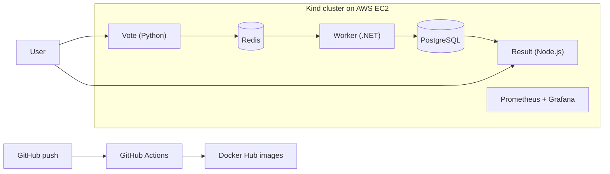

# Kubernetes Voting App with Monitoring and CI

A 5-service microservices voting app deployed on a multi-node Kind cluster on AWS EC2, monitored with Prometheus and Grafana, with a GitHub Actions pipeline that builds and pushes Docker images to Docker Hub.

## Architecture



## Tech Stack
AWS EC2, Docker, Kind, Kubernetes, kubectl, Helm, Prometheus, Grafana, GitHub Actions, Docker Hub

## What I Did
- Created a 3-node Kind cluster (1 control-plane + 2 workers) with `kind-config.yaml`, using `extraPortMappings` to expose NodePorts 31000, 31001 and 31002
- Deployed 5 services using manifests in `k8s-specifications/`: vote, result, worker, redis, db
- Installed Prometheus and Grafana with Helm using `install-monitoring.sh` in the `monitoring` namespace
- Built a GitHub Actions pipeline that builds and pushes the vote, result and worker images to Docker Hub on every push to `main`
- Fixed CI failures by adding `DOCKERHUB_USERNAME` and `DOCKERHUB_TOKEN` in GitHub Secrets

## Repository Structure
| Path | Purpose |
|---|---|
| `vote/`, `result/`, `worker/` | Service source code and Dockerfiles |
| `k8s-specifications/` | Kubernetes Deployments and Services |
| `kind-config.yaml` | Kind cluster configuration and port mappings |
| `install-monitoring.sh` | Installs Prometheus and Grafana with Helm |
| `.github/workflows/` | GitHub Actions CI pipeline |
| `troubleshooting.md` | Problems encountered and fixes |

## Docker Hub Images
- `snehald2026/voting-vote`: https://hub.docker.com/r/snehald2026/voting-vote
- `snehald2026/voting-result`: https://hub.docker.com/r/snehald2026/voting-result
- `snehald2026/voting-worker`: https://hub.docker.com/r/snehald2026/voting-worker

## Prerequisites
Docker, Kind, kubectl, Helm. An EC2 instance with at least 8 GB RAM. Security group inbound rules for ports 31002 (Vote), 31001 (Result) and 31000 (Grafana). Restrict these to your own IP instead of opening them to everyone.

## How to Run
```bash
git clone https://github.com/snehaldurgule/k8s-monitoring-project.git
cd k8s-monitoring-project

kind create cluster --config kind-config.yaml --name voting-cluster
kubectl get nodes

kubectl apply -f k8s-specifications/
kubectl get pods

bash install-monitoring.sh
kubectl get pods -n monitoring
```

## Access
| Service | URL |
|---|---|
| Vote | http://EC2-PUBLIC-IP:31002 |
| Result | http://EC2-PUBLIC-IP:31001 |
| Grafana | http://EC2-PUBLIC-IP:31000 |
| Prometheus | `kubectl port-forward svc/kube-prometheus-stack-prometheus 9090:9090 -n monitoring` |

Grafana login: user `admin`. Get the password with:
```bash
kubectl get secret -n monitoring kube-prometheus-stack-grafana \
  -o jsonpath="{.data.admin-password}" | base64 -d
```

## CI Pipeline
On every push to `main`, GitHub Actions builds the `vote`, `result` and `worker` images and pushes them to Docker Hub, tagged with the commit SHA and `latest`. Secrets used: `DOCKERHUB_USERNAME` and `DOCKERHUB_TOKEN`.

Workflow file: `.github/workflows/main.yaml`

## Screenshots
| Voting app | Result page |
|---|---|
|  |  |

| Grafana | Prometheus |
|---|---|
|  |  |

| GitHub Actions (green) | Docker Hub |
|---|---|
|  |  |

## Challenges and Learnings
1. **GitHub Actions failed at Docker Hub login.** Fixed by creating a Docker Hub access token and adding it as `DOCKERHUB_TOKEN` plus `DOCKERHUB_USERNAME` in GitHub Secrets. After re-running, all 3 builds passed.
2. **Kind NodePorts not reachable from the EC2 IP.** Fixed by adding `extraPortMappings` in `kind-config.yaml` for ports 31000 to 31002, which map the node container ports to the host.
3. **Pods in CrashLoopBackOff due to low RAM.** Moved from a t2.micro to a t2.large.

Learned how Kind nodes run as Docker containers and how host ports map to NodePorts, and how to monitor a cluster with Prometheus and Grafana using Helm.

## Future Improvements
- Add Argo CD for GitOps-based deployment

## Cost and Cleanup
Ran on an EC2 using AWS credits and stopped the instance after each session.

```bash
kind delete cluster --name voting-cluster
```
Then terminate the EC2 instance and check the AWS Billing console.

## Credits
Base app: Docker's [example-voting-app](https://github.com/dockersamples/example-voting-app), via [TrainWithShubham/k8s-kind-voting-app](https://github.com/LondheShubham153/k8s-kind-voting-app). I followed their tutorial and added the CI pipeline, port mappings and documentation.
